## posts

```mermaid
classDiagram
    class Post {
        <<Model>>
        +CharField title
        +SlugField slug
        +TextField body
        +CharField status
        +ForeignKey author
        +DateTimeField created_at
        +DateTimeField updated_at
        +DateTimeField published_at
        +BooleanField allow_comments
        +publish()
        +unpublish()
        +is_visible()
        +is_visible_to()
        +save()
        +get_absolute_url()
    }
    class PublishedManager {
        <<Model>>
        +get_queryset()
        +search()
    }
    class PostForm {
        <<Form>>
        +CharField title
        +TextField body
        +BooleanField allow_comments
        +clean_body()
    }
    class PostListView {
        <<View>>
        +paginate_by
        +get_queryset()
    }
    class PostDetailView {
        <<View>>
        +get_object()
    }
    class MyPostsView {
        <<View>>
        +paginate_by
        +get_queryset()
    }
    class AuthorRequiredMixin {
        <<View>>
        +get_object()
        +test_func()
    }
    class PostCreateView {
        <<View>>
        +form_class
        +form_valid()
    }
    class PostUpdateView {
        <<View>>
        +form_class
        +form_valid()
    }
    class PostDeleteView {
        <<View>>
        +form_valid()
    }
    class PostStatusView {
        <<View>>
        +publish
        +post()
    }

    Post --> PublishedManager : published
    PostListView --> PublishedManager : consulta
    PostDetailView --> Post : recupera
    MyPostsView --> Post : lista
    PostCreateView --> PostForm : usa
    PostUpdateView --> PostForm : usa
    AuthorRequiredMixin <|-- PostUpdateView
    AuthorRequiredMixin <|-- PostDeleteView
    AuthorRequiredMixin <|-- PostStatusView
    PostDeleteView --> Post : exclui
    PostStatusView --> Post : publica
```

**Figura 17 — Classes de projeto de posts**

`PublishedManager` existe para que nenhuma view precise lembrar de filtrar rascunho. A listagem, a busca, o perfil público e a gravação de comentário consultam por ele. A página do texto é a exceção: parte de `Post.objects` e confere `is_visible_to()`, porque o autor precisa abrir o próprio rascunho.

`search()` procura o termo no título e no corpo, sem diferenciar maiúsculas de
minúsculas, e parte do mesmo conjunto de publicados. Rascunho, portanto, nunca
aparece em resultado de busca.

`allow_comments` nasce verdadeiro. O autor desmarca a opção no editor para
encerrar a discussão de um texto, que é o fluxo A2 de UC10 e a regra RN17. Os
comentários já feitos continuam visíveis.

`is_visible_to()` é a regra RN01 escrita uma vez, no modelo. `publish()` e `unpublish()` guardam a transição de situação, e a data registrada é a da primeira publicação. `save()` gera o slug, com sufixo numérico quando já existe outro igual, e deixa de alterá-lo depois da primeira publicação, conforme RN10.

`test_func()`, em `AuthorRequiredMixin`, é a verificação de autoria exigida por RN09, feita no servidor. `PostUpdateView`, `PostDeleteView` e `PostStatusView` a herdam, e esconder o botão na tela não substitui isso.
