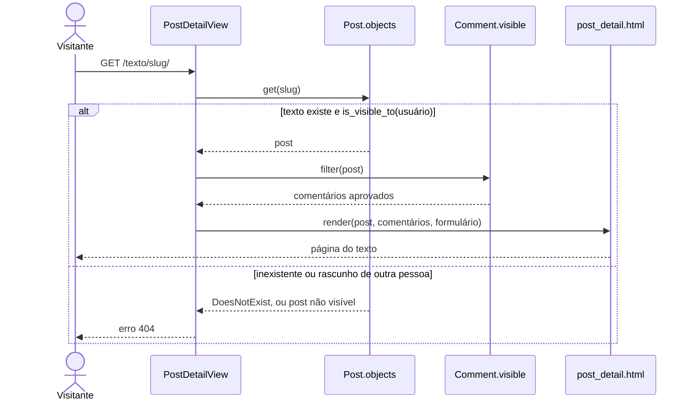

## UC02 — Ler post

**Figura 20 — Sequência de projeto do UC02**

A view parte do gerenciador padrão porque o autor precisa abrir o próprio rascunho, e confere `is_visible_to()` antes de responder. Para qualquer outra pessoa, rascunho e endereço inexistente terminam no mesmo 404, o que atende RN01.

A view entrega o formulário de comentário ao template, e é o template que decide exibi-lo: só em texto publicado, aberto a comentários e para quem tem sessão.
