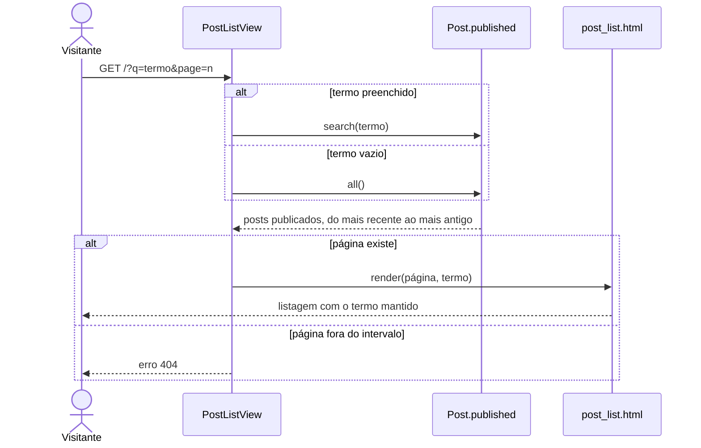

## UC03 — Buscar post

**Figura 21 — Sequência de projeto do UC03**

A busca não tem view própria. `PostListView` lê o parâmetro `q` e escolhe entre
`search()` e a listagem completa, e o mesmo template atende os dois casos. Como
a consulta sai de `Post.published`, RN04 vale sem que a view precise lembrar
dela.

`search()` filtra título e corpo com `icontains`, que o ORM transforma em
consulta parametrizada. O termo nunca é concatenado ao SQL, e é assim que RN03
se cumpre.
