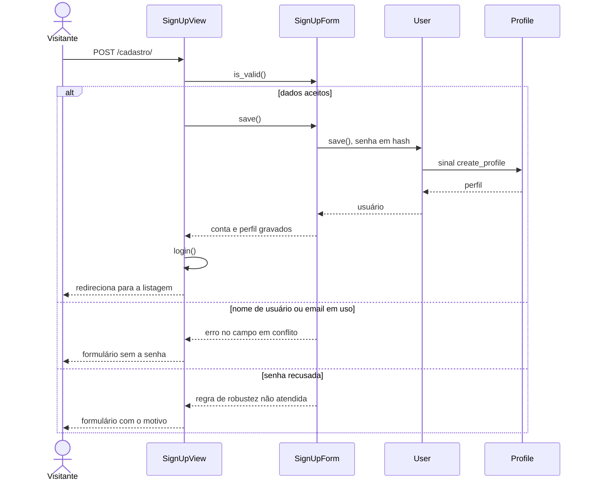

## UC05 — Cadastrar-se

**Figura 22 — Sequência de projeto do UC05**

O perfil nasce pelo sinal `create_profile`, disparado quando a conta é gravada, e é o que impede usuário sem perfil, venha a conta do cadastro, do admin ou do `createsuperuser`. A senha nunca chega ao banco como texto puro: o `save()` herdado do `UserCreationForm` grava o hash, o que é RN06.
